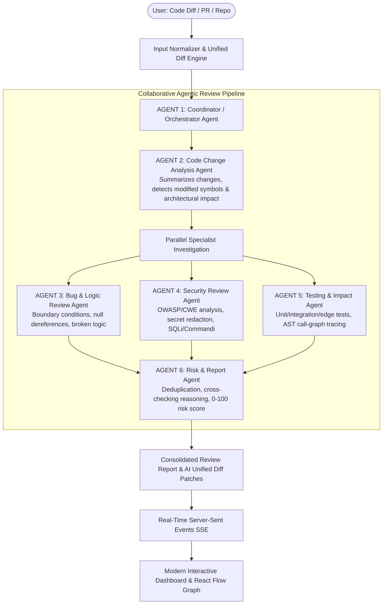

# ChangeLens — Agentic AI Code Change Risk Analyzer & Pre-Deployment Reviewer

[](https://www.python.org/)
[](https://fastapi.tiangolo.com/)
[](https://react.dev/)
[](https://www.typescriptlang.org/)
[](https://vitejs.dev/)
[](https://tailwindcss.com/)
[]()
[]()

> **GitHub Repository:** [https://github.com/Amanarun2907/IDT_Change_Lens.git](https://github.com/Amanarun2907/IDT_Change_Lens.git)

ChangeLens is an enterprise-grade **Agentic AI Code Change Risk Analyzer** that investigates software modifications at the repository level *before* they are merged or deployed.

Instead of relying on simplistic keyword heuristics or rigid regex matchers, ChangeLens utilizes a collaborative multi-agent workflow. Autonomous specialist LLM agents comprehend the code diff, evaluate functional and architectural impact, uncover subtle logical errors and unhandled boundary conditions, detect genuine exploitable security vulnerabilities with redacted code evidence, trace downstream caller dependencies and blast radius, determine targeted automated test requirements, and synthesize an executive pre-merge advisory decision (`APPROVE`, `NEEDS_HUMAN_REVIEW`, or `REQUEST_CHANGES`).

---

## 🏛️ System Architecture

ChangeLens is built on a clean, modular multi-agent architecture with a central **Coordinator Agent** delegating to four parallel specialists and a **Risk & Report Agent**:



### Agent Responsibilities & Roles

| Agent | Role | Responsibilities |
|---|---|---|
| **1. Coordinator Agent** | Lead Systems Architect & Orchestrator | Ingests the code change, normalizes git diffs, prepares analysis context, schedules parallel specialists, tracks progress, and streams real-time SSE execution events to the UI. |
| **2. Code Change Analysis Agent** | Senior Software Architect & Code Comprehension Specialist | Comprehends the git unified diff; infers architectural purpose and developer intent; identifies modified functions, classes, and dependencies; and explains functional and public API contract impact. |
| **3. Bug & Logic Review Agent** | Senior Quality & Logic Review Engineer | Detects logical errors, incorrect branching, off-by-one errors, boundary condition failures, null/None dereferences, unhandled empty inputs, and removed input validation guards. Returns code-grounded evidence. |
| **4. Security Review Agent** | Application Security & Cybersecurity Engineer | Contextual application security review for OWASP/CWE vulnerabilities: hardcoded secrets, SQL injection, command injection, path traversal, unsafe deserialization, SSRF, and sensitive data leakage. Automatically masks and redacts secrets. |
| **5. Testing & Impact Agent** | Test Automation & Impact Verification Specialist | Determines targeted unit tests, integration tests, regression tests, and edge-case tests with concrete inputs and expected outputs. Traces downstream callers and caller modules via AST. |
| **6. Risk & Report Agent** | Chief Risk Officer & Principal Report Synthesizer | Consolidates all findings, cross-checks specialist reasoning to eliminate duplicate or unsubstantiated claims, assigns an explainable 0–100 risk score, determines overall risk level (`LOW`, `MEDIUM`, `HIGH`, `CRITICAL`), and generates unified diff fix patches. |

---

## 🔒 Human-in-the-Loop Developer Assistance

ChangeLens is strictly a **developer-assistance and review tool**:
- **Zero Automated Actions:** ChangeLens never automatically commits changes, merges pull requests, or deploys applications.
- **Human Approval Required:** All findings, risk assessments, and suggested unified diff fix patches are advisory and require human developer inspection.
- **Honest Communication of Uncertainty:** Findings include calibrated confidence scores (0.0 to 1.0) and evidence references. If evidence is insufficient, further manual verification is recommended.
- **Secret Redaction:** Raw credentials, API keys, and secrets are automatically masked with `[REDACTED]` before sending prompts or rendering reports.

---

## 📋 Standardized Structured Finding Schema

Every finding produced by the system adheres to a validated Pydantic schema:

```json
{
  "id": "FIND-001",
  "finding_title": "Removed Input Validation Allows Negative Payment Transactions",
  "category": "BUG_LOGIC",
  "severity": "HIGH",
  "confidence": 0.90,
  "file_reference": "payment_service.py",
  "function_reference": "calculate_payment",
  "line_start": 3,
  "line_end": 5,
  "exact_evidence": "if amount <= 0: raise ValueError('Amount must be positive')",
  "explanation": "Validation check was removed from calculate_payment, permitting negative transactions.",
  "potential_impact": "Financial loss or negative invoice balance errors in downstream billing services.",
  "recommended_fix": "Restore parameter validation: if amount <= 0: raise ValueError('Amount must be positive')",
  "related_test_cases": [
    "test_payment_rejects_negative_amount",
    "test_payment_zero_amount_boundary"
  ],
  "source_agent": "bug_analysis",
  "is_ai_generated": true
}
```

---

## 🚀 Analysis Modes

1. **Manual Code / Git Diff (Mode C):**
   - Submit original code and updated code side-by-side, or paste a raw Git unified diff directly.
   - Includes 4 one-click demo presets:
     - *Harmless Change* (Documentation and greeting update)
     - *Logic Bug* (Bypassed negative payment validation)
     - *Security Vulnerability* (Hardcoded API key & raw SQL injection)
     - *Edge Case* (Missing null check & unhandled division by zero)
2. **GitHub Pull Request (Mode B):**
   - Provide a GitHub PR URL (`https://github.com/owner/repo/pull/15`).
   - Retrieves PR commits, modified files, and diff hunks to produce pre-merge advisory decisions with suggested inline review comments.
3. **GitHub Repository (Mode A):**
   - Provide a GitHub repo URL with optional base and target branches.
   - Extracts deep AST call-graphs, modified symbol tables, and downstream blast radius.

---

## ⚙️ Configurable Multi-Provider LLM Setup

ChangeLens is not coupled to a single model provider. It supports **Google Gemini**, **Groq**, **OpenAI**, or any **Custom OpenAI-Compatible Endpoint**:

Configure in `backend/.env` or via the interactive **Settings** page:

```env
# LLM Provider: "gemini" | "groq" | "openai" | "custom"
LLM_PROVIDER=gemini

# Primary API Key
LLM_API_KEY=your_api_key_here

# Provider-Specific Keys (Optional)
GEMINI_API_KEY=
GROQ_API_KEY=
OPENAI_API_KEY=

# Model Name
# Gemini: "gemini-2.5-flash", "gemini-1.5-flash", "gemini-1.5-pro"
# Groq: "llama-3.3-70b-versatile", "deepseek-r1-distill-llama-70b"
# OpenAI: "gpt-4o-mini", "gpt-4o"
LLM_MODEL=gemini-2.5-flash

# Safety & Offline Fallback (Useful for CI/CD test suites without keys)
ALLOW_OFFLINE_FALLBACK=true
```

---

## 🛠️ Local Installation & Development

### 1. Prerequisites
- Python 3.11+ or 3.12+
- Node.js 18+ and npm
- Git

### 2. Backend Setup
```bash
# Navigate to the workspace root
cd IDT

# Set up virtual environment
python -m venv venv
.\venv\Scripts\activate

# Install backend dependencies
pip install -r backend/requirements.txt

# Configure environment
cp backend/.env.example backend/.env

# Start FastAPI backend server (http://localhost:8000)
$env:PYTHONPATH="backend"
python -m uvicorn app.main:app --host 0.0.0.0 --port 8000 --reload
```

### 3. Frontend Setup
```bash
# In a separate terminal
cd frontend
npm install

# Start Vite dev server (http://localhost:5173)
npm run dev
```

### 4. Running the Complete Test Suite
```bash
$env:PYTHONPATH="backend"
.\venv\Scripts\python -m pytest backend/tests -v
```
All 26 test suites (AST analysis, risk engine, security scanners, diff normalization, agent orchestration, and API endpoints) will run and pass.

---

## 🚢 Deployment Guide

### Deploying the Backend on Render

1. Fork or push this repository to GitHub: `https://github.com/Amanarun2907/IDT_Change_Lens.git`
2. Log in to [Render](https://render.com) and click **New +** &rarr; **Blueprint**.
3. Select your GitHub repository. Render will automatically detect `render.yaml`.
4. Configure the environment variables in the Render Dashboard:
   - `LLM_PROVIDER`: `gemini` (or `groq` / `openai`)
   - `LLM_API_KEY`: Your Gemini or Groq API key
   - `PYTHON_VERSION`: `3.12.0`
5. Click **Apply**. Render will automatically build the backend via:
   ```bash
   pip install -r requirements.txt
   uvicorn app.main:app --host 0.0.0.0 --port $PORT
   ```
   Your backend API will be live at `https://your-backend.onrender.com`.

### Deploying the Frontend on Netlify

1. Log in to [Netlify](https://netlify.com) and click **Add new site** &rarr; **Import an existing project**.
2. Select your GitHub repository.
3. Configure the build settings (or let Netlify read `netlify.toml`):
   - **Base directory:** `frontend`
   - **Build command:** `npm run build`
   - **Publish directory:** `dist`
4. Add the backend URL as an environment variable in Netlify:
   - `VITE_API_URL`: `https://your-backend.onrender.com`
5. Click **Deploy Site**. Netlify will build the frontend, and Single Page Application redirects (`/* -> /index.html`) will automatically handle client-side routing.

---

## 🧪 Demonstration Walkthrough

1. Open the ChangeLens Dashboard at `http://localhost:5173/` (or your Netlify URL).
2. Click **New Analysis** and navigate to the **Manual Code / Diff** tab.
3. Click any of the Quick Demo Scenarios:
   - **Harmless Change:** Observe that the multi-agent pipeline completes with score < 20 (`LOW` risk, `APPROVE`).
   - **Logic Bug:** Observe how the Bug Agent detects the bypassed validation check, line numbers, and impact (`HIGH` risk, `REQUEST_CHANGES`).
   - **Security Vulnerability:** Watch the Security Agent flag the SQL injection and hardcoded token with code evidence (`CRITICAL` risk, `REQUEST_CHANGES`).
4. Click **Launch Agentic Review** to watch the live SSE timeline as the Coordinator Agent delegates to the specialist agents in parallel.
5. In the **Analysis Results** view:
   - Inspect the **Prioritized Findings** tab with expandable evidence and fix recommendations.
   - Explore the **Dependency Graph** tab with interactive React Flow nodes and edges.
   - View the **Suggested Patches** tab to see unified diff fix patches.
   - Click **Export PDF** or **Export JSON** to download executive change reports.

---

## 📄 License

This project is licensed under the MIT License — see the LICENSE file for details.
